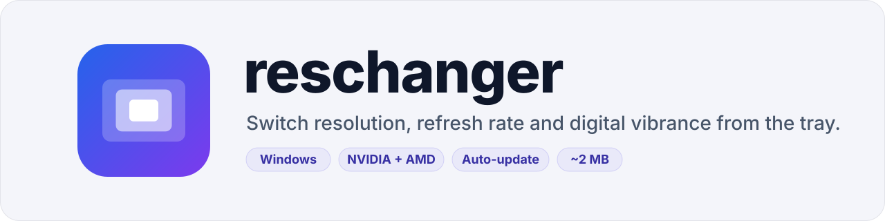

<p align="center">
  <picture>
    <source media="(prefers-color-scheme: dark)" srcset=".github/assets/banner-dark.svg">
    
  </picture>
</p>

<p align="center">
  <a href="https://github.com/igorovh/reschanger/releases/latest"></a>
  <a href="https://github.com/igorovh/reschanger/releases"></a>
  
  <a href="LICENSE"></a>
</p>

A lightweight Windows tray app for quickly switching monitor resolution, refresh rate and digital vibrance (NVIDIA and AMD), automatically when a game starts or with one click. Built with Tauri v2 (Rust + WebView2), with automatic updates.

## Download and install

1. Open the [latest release](https://github.com/igorovh/reschanger/releases/latest).
2. Under **Assets**, download the file ending in `_x64-setup.exe` (for example `reschanger_1.0.0_x64-setup.exe`). Ignore the `.sig` and `latest.json` files.
3. Run the downloaded file. If Windows SmartScreen shows "Windows protected your PC", click **More info**, then **Run anyway**. The app is not code-signed yet, so Windows does not recognize it.
4. Follow the installer. It installs for your user only and does not need administrator rights.
5. reschanger starts and shows its window. When you close the window, the app keeps running in the system tray (the icon near the clock; you may need to click the `^` arrow to see it). Left-click the icon to open the window, right-click it to apply presets.

You only need to do this once. When a new version comes out, the app shows an **Install and restart** banner (also available from the tray menu) and updates itself.

To uninstall, open **Settings → Apps → Installed apps**, find **reschanger** and choose **Uninstall**.

## Requirements

- Windows 10/11 (WebView2 ships with the OS; the installer adds it if missing)
- [Bun](https://bun.sh)
- [Rust](https://rustup.rs) (`stable-x86_64-pc-windows-msvc` toolchain)

In PowerShell with script execution blocked, use `bun.cmd` instead of `bun`.

## Development

```powershell
bun install
bun run dev
```

## Checks

```powershell
bun run check
bun run typecheck
cargo test --manifest-path src-tauri/Cargo.toml
```

## Local build

The build produces signed updater artifacts, so it needs the private key:

```powershell
$env:TAURI_SIGNING_PRIVATE_KEY = Get-Content -Raw ~\.tauri\reschanger.key
$env:TAURI_SIGNING_PRIVATE_KEY_PASSWORD = ""
bun run build
```

The installer is written to `src-tauri\target\release\bundle\nsis\`.

## Releases and auto-update

1. Bump `version` in `package.json` (Tauri reads the version from there).
2. Commit, push to `master` and tag the same version: `git tag v1.0.0 && git push origin v1.0.0`.
3. The `.github/workflows/release.yml` workflow builds the NSIS installer, signs it and publishes a release with `latest.json`.

The app checks `https://github.com/igorovh/reschanger/releases/latest/download/latest.json` 15 s after startup and then every 6 hours. You can also check manually from the tray menu or the settings dialog. Updates install in `passive` mode: a progress bar, no UAC prompt, since the app installs per user.

Repository secrets required by CI:

- `TAURI_SIGNING_PRIVATE_KEY`: contents of `~\.tauri\reschanger.key`
- `TAURI_SIGNING_PRIVATE_KEY_PASSWORD`: the key password (empty)

If the private key is lost, installed copies will not accept further updates.

## Project structure

- `src/renderer`: UI (React + Vite)
- `src/shared`: types and translations (`translations.json` is shared with Rust)
- `src-tauri/src`: backend. Monitor WinAPI calls (`display.rs`), process detection and system helpers (`system.rs`), preset logic (`core.rs`), tray, updater

## Local data

Settings and presets (same format as the Electron version):

```text
%APPDATA%\reschanger\settings.json
```

## License

reschanger is free software released under the [GNU General Public License v3.0](LICENSE). You can use, study, share and modify it, but if you distribute a modified version, it must stay open source under the same license.
